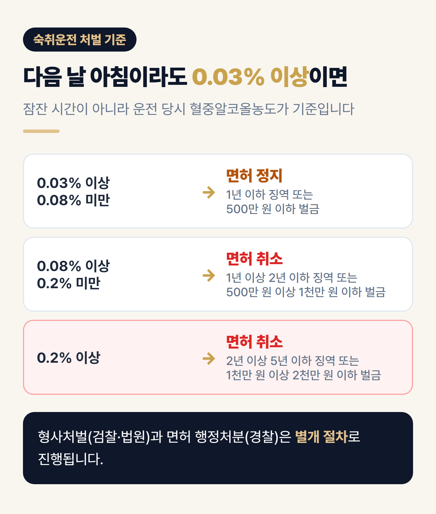
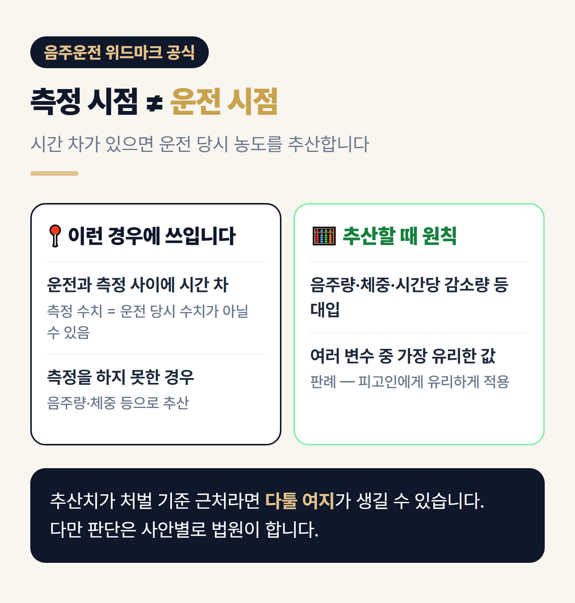
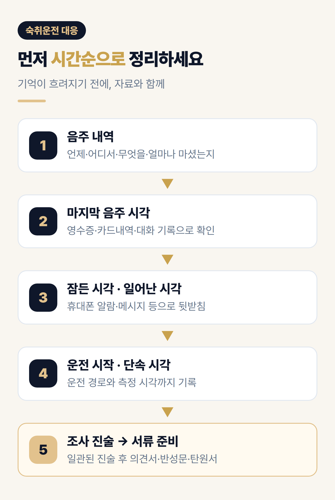

안녕하세요, 리더스 합동 법무사 사무소입니다 😊

전날 저녁 회식이나 모임에서 술을 마셨습니다.  
집에 와서 충분히 잤다고 생각했고,  
아침에 평소처럼 차를 몰고 출근하던 길이었습니다.

그런데 아침 단속에서 측정기를 불었더니  
수치가 나왔습니다.

상담을 하다 보면 이런 말씀을 자주 듣습니다.

> "밤새 자고 일어났는데, 이것도 음주운전인가요?"

결론부터 말씀드리면, **잠을 잤는지가 아니라 운전 당시 혈중알코올농도가 기준**입니다.  
다만 측정 시점과 운전 시점 사이의 관계, 그리고 **위드마크 공식**을 어떻게 적용하느냐에 따라  
따져 볼 부분이 생기기도 합니다.  
오늘은 숙취운전의 처벌 기준과, 지금 무엇부터 정리해야 하는지 말씀드리겠습니다.

> ⚖️ **핵심 정리**  
> ✔ 다음 날 아침이라도 운전 당시 혈중알코올농도가 **0.03% 이상**이면 음주운전 처벌 대상입니다  
> ✔ 알코올 분해 속도는 사람마다 달라 **잠잔 시간만으로 판단할 수 없습니다**  
> ✔ 운전과 측정 사이에 시간 차가 있으면 **위드마크 공식**으로 운전 당시 농도를 추산하기도 합니다  
> ✔ 판례는 위드마크 공식에서 **피고인에게 가장 유리한 값**을 적용해야 한다는 입장입니다  
> ✔ 대응의 출발점은 음주부터 단속까지를 **시간순으로 정리**하는 것입니다

---

## 📌 숙취운전도 음주운전인가요? — 기준은 '운전 당시 농도'

도로교통법 제44조는 술에 취한 상태에서 운전하는 것을 금지하고,  
혈중알코올농도 **0.03% 이상**이면 술에 취한 상태로 봅니다.  
처벌은 도로교통법 제148조의2에 따라 농도 구간별로 달라집니다.

법에는 "언제 마셨는지"를 따지는 기준이 없습니다.  
**전날 밤에 마셨든, 자고 일어났든, 운전 당시 농도가 0.03% 이상이면** 음주운전입니다.

| 혈중알코올농도 | 형사처벌 | 면허 행정처분 |
|---|---|---|
| **0.03% 이상 ~ 0.08% 미만** | 1년 이하 징역 또는 500만 원 이하 벌금 | 면허 **정지** |
| **0.08% 이상 ~ 0.2% 미만** | 1년 이상 2년 이하 징역 또는 500만 원 이상 1천만 원 이하 벌금 | 면허 **취소** |
| **0.2% 이상** | 2년 이상 5년 이하 징역 또는 1천만 원 이상 2천만 원 이하 벌금 | 면허 **취소** |

> ✔ **형사처벌**(검찰·법원)과 **면허 행정처분**(경찰)은 **별개 절차**입니다.  
> 한쪽 결과가 다른 쪽에 그대로 이어지는 것이 아니므로, 각각 따로 대응을 준비해야 합니다.

구간별 기준을 더 자세히 보시려면 「[수원 음주운전 처벌 기준 총정리](/board/suwon-dui-punishment-guide/)」를 참고하세요.

---

## 📌 "자고 일어났으니 괜찮다"가 통하지 않는 이유

많은 분들이 "몇 시간 자면 술이 깬다"는 나름의 기준을 가지고 계십니다.  
하지만 **알코올이 분해되는 속도는 사람마다 다릅니다.**

| 영향을 주는 요소 | 내용 |
|---|---|
| **체중** | 같은 양을 마셔도 체중에 따라 농도가 달라질 수 있습니다 |
| **성별** | 체내 수분 비율 등의 차이로 영향이 있을 수 있습니다 |
| **음주량·술 종류** | 마신 양과 도수에 따라 체내 알코올 양이 달라집니다 |
| **체질·컨디션** | 분해 능력은 개인차가 큽니다 |

그래서 "여섯 시간 잤으니 괜찮다", "평소엔 아침에 멀쩡했다"는 것은  
**법적으로 판단 기준이 되지 못합니다.**  
측정 결과 0.03% 이상이 나왔다면, 잠잔 시간과 관계없이 음주운전 사건으로 진행됩니다.

> ❗ 전날 늦게까지, 많이 마셨다면  
> 다음 날 아침 운전은 아예 하지 않는 것이 가장 확실한 예방입니다.

---

## 📌 음주운전 위드마크 공식이란? — 측정 시점과 운전 시점이 다를 때

단속 현장에서 바로 측정했다면 그 수치가 기준이 됩니다.  
그런데 이런 경우가 있습니다.

- 운전을 마친 뒤 **한참 지나서** 측정이 이루어진 경우
- 사고 등으로 **측정을 하지 못한** 경우

이때 쓰이는 것이 **위드마크 공식**입니다.  
마신 술의 양, 체중 등과 **시간이 지나면서 줄어드는 양(시간당 감소량)** 을 이용해  
**운전 당시의 혈중알코올농도를 거꾸로 추산하는 방법**입니다.

여기서 중요한 원칙이 있습니다.  
위드마크 공식에 들어가는 값들은 사람마다, 상황마다 달라질 수 있기 때문에,  
판례는 이 공식을 적용할 때 **여러 변수 중 피고인에게 가장 유리한 값을 적용해야 한다**는 입장입니다.

> ✔ 그래서 추산된 수치가 **처벌 기준(0.03%, 0.08% 등) 근처**라면  
> 어떤 값을 넣었는지, 계산의 전제가 맞는지를 두고 **다툴 여지가 생길 수 있습니다.**  
> 다만 결과는 구체적인 사실관계와 자료에 따라 달라지며, 법원이 사안별로 판단합니다.

---

## 📌 혈중알코올농도 '상승기'는 무엇이 문제인가요?

술을 마신 직후 혈중알코올농도가 바로 최고치가 되는 것은 아닙니다.  
**마신 뒤 일정 시간 동안은 농도가 올라가는 시기(상승기)** 가 있습니다.

그래서 이런 주장이 나오기도 합니다.

> "운전할 때는 농도가 올라가는 중이었고, 측정할 때 수치가 더 높게 나온 것이다."

즉 **측정 수치가 운전 당시보다 높게 나왔을 수 있다**는 점이 다툼이 되는 것입니다.

다만 이 부분은 마지막으로 마신 시각, 운전 시각, 측정 시각이 어떻게 되는지 등  
**구체적인 사정에 따라 법원이 사안별로 판단**합니다.  
상승기라는 이유만으로 결론이 정해지는 것은 아니므로,  
무엇보다 **시간 관계를 정확히 정리하는 것**이 먼저입니다.

---

## 📌 지금 무엇부터 해야 하나요? — 시간순 정리와 진술

숙취운전 사건에서는 **"언제"** 가 핵심입니다.  
기억이 흐려지기 전에 아래 내용을 **시간순으로** 적어 두세요.

1. **언제·어디서·무엇을·얼마나** 마셨는지
2. **마지막으로 마신 시각**
3. **잠든 시각과 일어난 시각**
4. **운전을 시작한 시각과 단속(측정) 시각**

그리고 이를 뒷받침할 **자료**를 함께 모아 두시는 것이 좋습니다.

- 술집·식당 **영수증**, **카드 결제 내역**
- 일행과 주고받은 **문자·카카오톡 대화**
- 귀가·출발 시각을 보여 주는 기록

경찰 조사에서는 이 시간 관계를 **일관되게** 진술하는 것이 중요합니다.  
처음과 나중의 진술이 엇갈리면 신빙성을 의심받을 수 있습니다.  
진술 준비는 「[진술서, 기억나는 대로 쓰면 왜 불리해질까](/board/statement-consistency/)」와  
「[경찰 조사 전에 무엇부터 해야 할까](/board/accused-police-summons/)」을 참고하세요.

정리가 끝난 뒤에는 사안에 따라  
**의견서·반성문·탄원서** 등 서류를 준비하게 됩니다.  
초범이라면 「[수원 음주운전 초범 벌금과 집행유예 기준](/board/suwon-dui-first-offense-fine/)」,  
면허 처분에 대응하신다면 「[음주운전 면허취소, 이의신청·행정심판 서류 대응](/board/suwon-dui-license-revocation-appeal/)」도 함께 보세요.

---

## 🧱 혼자 하다 막히는 지점

- **시간 재구성** — 전날 밤부터 아침까지의 기억이 흐릿해 시각이 서로 맞지 않습니다
- **자료 연결** — 영수증·카드내역·대화 기록을 시간표와 어떻게 맞춰야 할지 막막합니다
- **위드마크·상승기 주장** — 내 사안에서 따져 볼 부분이 있는지 판단하기 어렵습니다
- **진술 일관성** — 조사에서 무엇을 어떻게 말해야 앞뒤가 맞는지 정리가 필요합니다
- **서류 구성** — 의견서·반성문·탄원서에 무엇을 담고 어떤 자료를 붙일지 고민됩니다

> 👉 숙취운전 사건은 **시간표 한 장**이 대응의 뼈대가 됩니다.  
> 이 정리가 탄탄해야 진술도, 이후 서류도 흔들리지 않습니다.

---

## 🙋 자주 묻는 질문

**Q. 전날 밤에 마시고 8시간 넘게 잤는데도 처벌되나요?**  
A. 잠잔 시간은 처벌 기준이 아닙니다. 운전 당시 혈중알코올농도가 0.03% 이상이었다면 음주운전에 해당하며, 알코올 분해 속도는 체중·음주량·체질 등에 따라 사람마다 다릅니다.

**Q. 위드마크 공식으로 계산하면 무조건 유리한가요?**  
A. 그렇지는 않습니다. 판례는 위드마크 공식을 적용할 때 피고인에게 가장 유리한 값을 쓰도록 하고 있지만, 추산 결과가 처벌 기준을 넘는다면 그대로 처벌 근거가 될 수 있습니다. 추산치가 기준 근처일 때 다툴 여지가 생길 수 있다는 정도로 이해하시는 것이 정확합니다.

**Q. 형사처벌과 면허 처분은 같이 정해지나요?**  
A. 아닙니다. 형사처벌은 검찰·법원이, 면허 정지·취소는 경찰이 담당하는 별개 절차입니다. 기한과 제출 서류도 각각 다르므로 따로 확인하셔야 합니다. 2회 이상이라면 「[수원 음주운전 2회, 법원 제출 의견서 작성방법](/board/suwon-dui-second-opinion-letter/)」도 참고하세요.

---

## ✅ 마무리 정리

- 숙취운전도 운전 당시 혈중알코올농도 **0.03% 이상**이면 음주운전 처벌 대상입니다
- 처벌은 **농도 구간별**로 달라지고, 면허는 0.08% 미만 **정지**, 이상 **취소**가 원칙입니다
- 알코올 분해 속도는 **사람마다 달라** 잠잔 시간만으로 판단할 수 없습니다
- **위드마크 공식**은 피고인에게 **가장 유리한 값**을 적용해야 하며, 기준 근처라면 다툴 여지가 생길 수 있습니다
- **상승기** 문제는 법원이 사안별로 판단합니다
- 음주부터 단속까지 **시간순 정리**와 **일관된 진술**이 먼저, 그다음이 서류입니다

저희 리더스 합동 법무사 사무소는  
**시간 관계 정리부터 의견서·반성문·탄원서, 면허 이의신청·행정심판 청구서까지**  
제출 서류 작성을 이어서 도와드립니다.

수원·용인·화성·오산·평택 등 경기 남부에서 진행하신다면  
「[음주운전 초범 안내](/dui/first-offense/)」도 함께 참고하실 수 있습니다.

> ⚠️ 리더스 합동 법무사 사무소는 의견서·반성문·탄원서, 면허 이의신청·행정심판 청구서 등 서류의 작성을 대리합니다. 형사 변론과 소송대리는 변호사의 업무범위입니다. 처분과 판결은 수사기관·법원의 판단에 따르며 결과를 보장하지 않습니다.

---

아침 단속 이후 무엇부터 해야 할지 막막하시다면  
언제든지 연락 주세요 😊  
기억하시는 시간부터 함께 차근차근 정리해 드리겠습니다.

**법무사 직통 [031-225-6885](tel:0312256885) · [상담 게시판](/inquiry/)**

긴 글 읽어주셔서 감사합니다 🙏

리더스 합동 법무사 사무소 드림.
