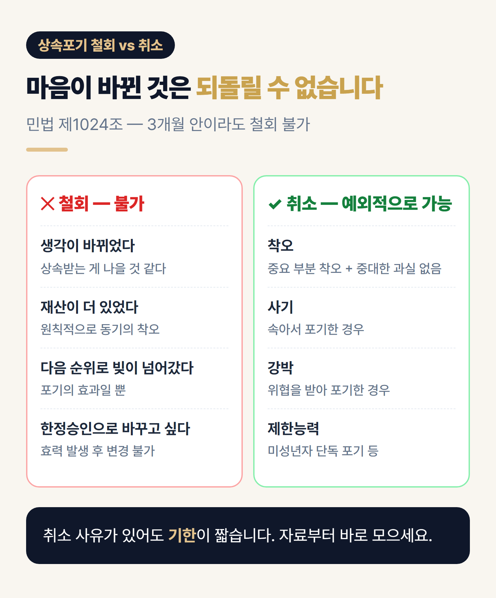
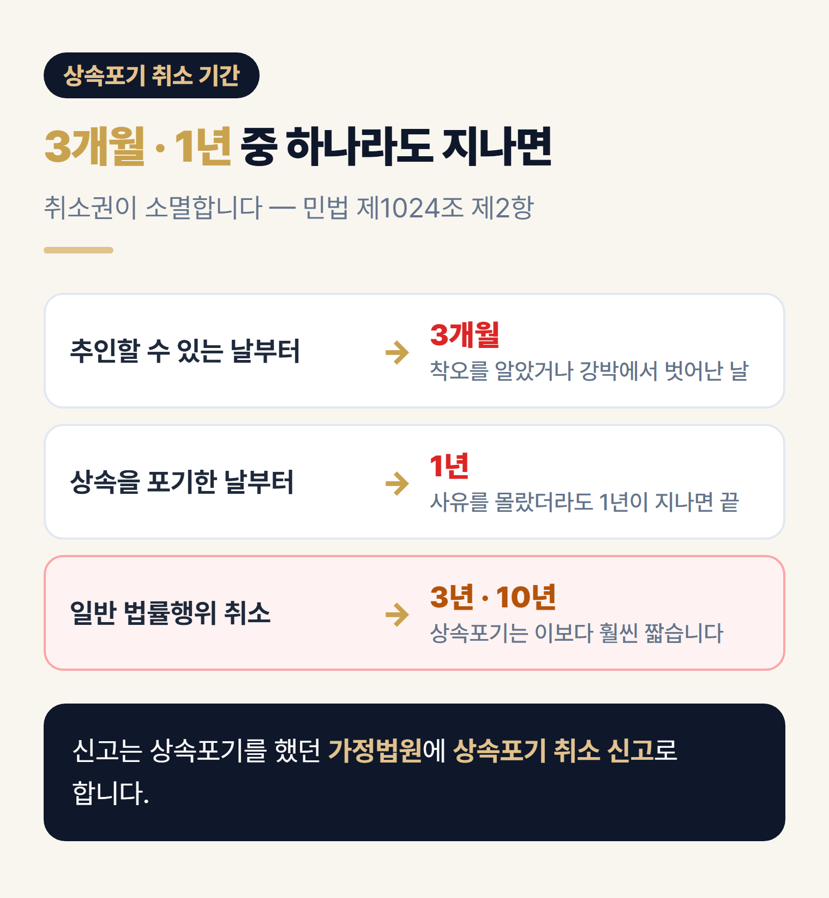
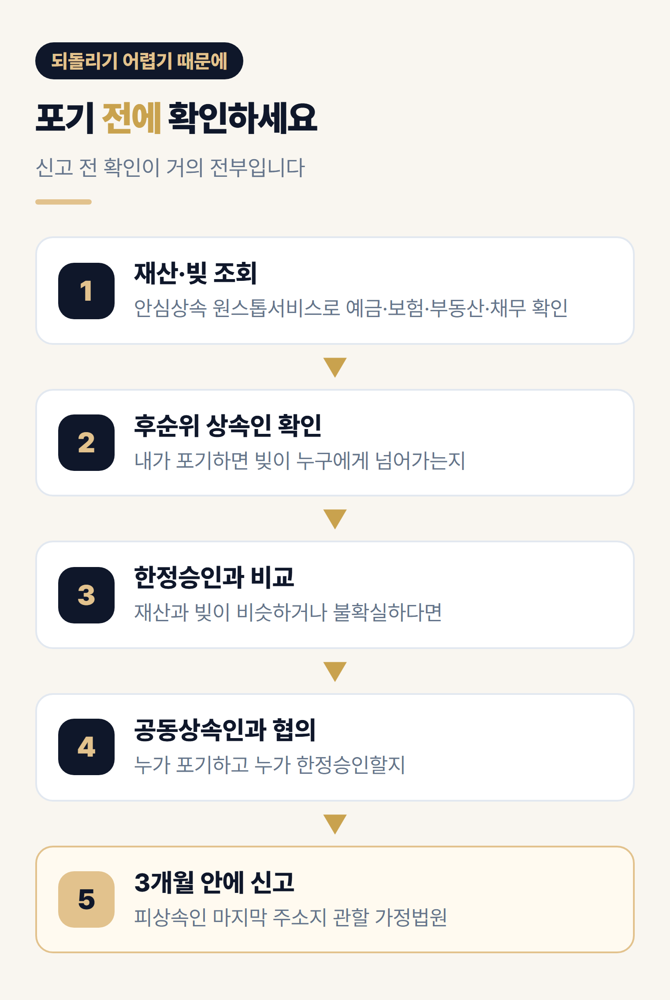

안녕하세요, 리더스 합동 법무사 사무소입니다 😊

빚이 많은 것 같아 서둘러 상속포기를 했습니다.  
그런데 몇 주 뒤,  
생각하지 못했던 예금이나 부동산이 있다는 것을 알게 됐습니다.

혹은 내가 포기하면서  
빚이 형제나 조카에게 넘어간다는 사실을 뒤늦게 알게 된 경우도 있습니다.

상담을 하다 보면 이런 질문을 자주 받습니다.

> "아직 3개월이 안 지났는데, 상속포기를 취소할 수 있나요?"

결론부터 말씀드리면, **마음이 바뀌었다는 이유만으로는 되돌릴 수 없습니다.**  
다만 **착오·사기·강박** 등 법이 정한 사유가 있다면 예외적으로 **취소**를 다퉈 볼 수 있습니다.  
오늘은 상속포기 철회와 취소의 차이, 그리고 기한을 정리해 드리겠습니다.

> ⚖️ **핵심 정리**  
> ✔ 상속포기는 3개월(고려기간) 안이라도 **철회할 수 없습니다** (민법 제1024조 제1항)  
> ✔ **착오·사기·강박·제한능력** 등 민법 총칙상 사유가 있을 때만 **취소**할 수 있습니다  
> ✔ 취소는 **추인할 수 있는 날부터 3개월, 포기한 날부터 1년** 안에 해야 합니다  
> ✔ "재산이 더 많았다"는 사정만으로는 취소가 **인정되기 쉽지 않습니다**  
> ✔ 그래서 가장 중요한 것은 **포기 전에 재산·빚을 충분히 확인하는 것**입니다

---

## 📌 상속포기 철회 — 3개월 안이라도 안 됩니다

민법 제1024조 제1항은 이렇게 정하고 있습니다.

> 상속의 승인이나 포기는 제1019조 제1항의 기간 내에도 이를 취소하지 못한다.

여기서 말하는 "취소"는 흔히 말하는 **철회**, 즉 **마음이 바뀌어 없던 일로 하는 것**을 뜻합니다.  
상속을 안 날부터 3개월이라는 기간이 아직 남아 있더라도,  
한 번 법원에 신고해 효력이 생긴 상속포기는 **스스로 거둬들일 수 없습니다.**

| 이런 이유라면 | 결과 |
|---|---|
| 생각해 보니 상속을 받는 게 나을 것 같다 | **철회 불가** |
| 포기 후 예금·부동산이 더 있다는 것을 알았다 | 원칙적으로 **철회 불가** (아래 '착오' 참고) |
| 내가 포기하면 다음 순위로 빚이 넘어가는 줄 몰랐다 | 원칙적으로 **철회 불가** |
| 포기 대신 한정승인으로 바꾸고 싶다 | 포기 효력이 생긴 뒤에는 **변경 불가** |

> ✔ 상속포기는 다른 상속인·채권자 등 여러 사람의 법률관계를 확정하는 절차입니다.  
> 그래서 법은 한 번 정해진 결과를 쉽게 뒤집지 못하도록 하고 있습니다.

참고로 법원이 아직 **신고를 수리하기 전**이라면 상황이 다를 수 있으므로,  
신고 직후 마음이 바뀌었다면 **담당 가정법원에 진행 상태와 취하 가능 여부를 바로 확인**하세요.

---

## 📌 상속포기 취소 — 예외적으로 가능한 경우

같은 조문 제2항은 **민법 총칙에 따른 취소**는 여전히 할 수 있다고 정합니다.  
즉, 포기 의사 자체에 하자가 있었던 경우입니다.

| 사유 | 내용 |
|---|---|
| **착오** (민법 제109조) | 포기의 **중요한 부분**에 착오가 있고, 본인에게 **중대한 과실이 없을 것** |
| **사기** (민법 제110조) | 다른 사람에게 속아서 포기한 경우 |
| **강박** (민법 제110조) | 위협을 받아 어쩔 수 없이 포기한 경우 |
| **제한능력** | 미성년자가 법정대리인 동의 없이 하는 등 행위능력에 문제가 있었던 경우 |

### "재산이 더 많았다"는 착오가 될까요?

가장 많이 물으시는 부분입니다.  
상속재산이 생각보다 많았다는 사정은 보통 **포기를 결심하게 된 동기**에 관한 착오로 봅니다.  
동기의 착오는 그 동기가 포기의 내용으로 표시되는 등 특별한 사정이 없으면  
**취소 사유로 인정되기 어렵습니다.**

또 재산 조회를 충분히 하지 않고 서둘러 포기했다면  
**중대한 과실**이 문제 될 수도 있습니다.  
결국 취소가 인정될지는 **구체적인 경위와 자료**에 따라 달라집니다.

> ❗ 반대로 다른 상속인이 "빚만 있다"고 속여서 포기하게 만든 경우라면  
> 사기를 이유로 한 취소를 검토해 볼 수 있습니다.  
> 이때는 **누가, 언제, 무엇을 말했는지** 보여 줄 자료가 핵심입니다.

---

## 📌 상속포기 취소 기간 — 3개월, 1년

취소 사유가 있더라도 **기한**이 짧습니다.  
민법 제1024조 제2항 단서에 따라 아래 두 기한 중 **하나라도 지나면** 취소권이 소멸합니다.

| 기준일 | 기한 |
|---|---|
| **추인할 수 있는 날** (착오를 알았거나, 강박에서 벗어난 날 등) | **3개월** 이내 |
| **상속을 포기한 날** | **1년** 이내 |

일반 법률행위의 취소 기간(3년·10년)보다 **훨씬 짧습니다.**  
"나중에 정리하자" 하다가 기한을 넘기는 경우가 많으니,  
취소 사유가 의심되면 **바로 자료를 모으고 절차를 확인**하셔야 합니다.

취소는 상속포기 신고를 했던 **가정법원**에 **상속포기 취소 신고**를 하는 방식으로 진행합니다.  
다만 법원이 신고를 수리했다고 해서 취소의 효력이 최종 확정되는 것은 아니고,  
다툼이 있으면 그 효력은 이후 **민사소송에서 다시 판단**될 수 있습니다.

---

## 📌 되돌리기 어렵기 때문에 — 포기 전에 확인할 것

상속포기는 **되돌리기 어려운 결정**입니다.  
그래서 신고 전에 아래 순서로 확인하시는 것이 가장 안전합니다.

1. **재산과 빚 조회** — 안심상속 원스톱서비스(사망자 등 재산조회 통합처리)로 예금·보험·부동산·자동차·채무를 한 번에 확인
2. **후순위 상속인 확인** — 내가 포기하면 빚이 누구에게 넘어가는지 (「[상속포기하면 빚은 누구에게 넘어갈까](/board/renunciation-next-heir/)」)
3. **한정승인과 비교** — 재산과 빚이 비슷하거나 불확실하다면 한정승인이 나을 수 있습니다 (「[상속포기 vs 한정승인](/board/inheritance-renounce-vs-limited/)」)
4. **공동상속인과 협의** — 누가 포기하고 누가 한정승인할지 조합을 정리
5. **기한 내 신고** — 상속개시를 안 날부터 **3개월** 안에, 피상속인 마지막 주소지 관할 가정법원에

그리고 포기 전후로 돌아가신 분의 예금을 인출하거나 재산을 처분하면  
**단순승인**으로 볼 수 있으니 주의하세요.  
자세한 내용은 「[상속포기 전에 이것만은 하지 마세요](/board/before-renunciation-dont/)」에 정리해 두었습니다.

> ✔ 3개월이 지난 뒤에 큰 빚을 알게 되었다면 **특별한정승인**을 검토할 수 있습니다.  
> 「[특별한정승인, 기간 지난 빚](/board/special-limited-acceptance/)」을 참고하세요.

---

## 🧱 혼자 하다 막히는 지점

- **철회인지 취소인지** — 내 사정이 단순 변심인지, 취소 사유가 되는지 판단이 어렵습니다
- **기한 계산** — "추인할 수 있는 날"이 언제인지, 3개월·1년 중 무엇이 먼저 끝나는지 헷갈립니다
- **자료 정리** — 속았거나 착오했다는 경위를 어떤 자료로 보여 줄지 막막합니다
- **포기 전 판단** — 재산과 빚이 비슷할 때 포기와 한정승인 중 무엇이 맞는지 고민됩니다
- **가족 간 조합** — 후순위로 빚이 넘어가지 않게 하려면 누가 무엇을 해야 하는지 정리가 필요합니다

> 👉 상속포기는 **신고 전 확인**이 거의 전부입니다.  
> 이미 신고했다면, 취소 사유와 **기한**부터 바로 확인하셔야 합니다.

---

## 🙋 자주 묻는 질문

**Q. 상속포기 신고 후 아직 3개월이 안 지났는데 철회할 수 있나요?**  
A. 아닙니다. 민법 제1024조 제1항에 따라 상속포기는 3개월의 고려기간 안이라도 철회할 수 없습니다. 다만 법원이 아직 신고를 수리하기 전이라면 담당 법원에 진행 상태를 바로 확인해 보세요.

**Q. 포기한 뒤에 돌아가신 분 명의 예금이 발견됐어요. 다시 상속받을 수 있나요?**  
A. 재산이 더 있었다는 사정만으로는 취소가 인정되기 어렵습니다. 보통 동기의 착오로 보기 때문입니다. 다른 상속인에게 속았거나 하는 등 구체적인 사유가 있는지, 그리고 3개월·1년 기한이 남아 있는지를 먼저 확인해야 합니다.

**Q. 상속포기를 한정승인으로 바꿀 수 있나요?**  
A. 상속포기의 효력이 생긴 뒤에는 한정승인으로 바꿀 수 없습니다. 재산과 빚이 불확실하다면 처음부터 한정승인을 검토하시는 것이 안전합니다. 가족 여럿이 함께 결정해야 한다면 「[상속인 여럿, 한정승인·상속포기 조합](/board/multiple-heirs-strategy/)」도 참고하세요.

---

## ✅ 마무리 정리

- 상속포기는 **3개월 안이라도 철회할 수 없습니다**
- **착오·사기·강박·제한능력** 등 민법상 사유가 있을 때만 예외적으로 **취소**할 수 있습니다
- 취소는 **추인할 수 있는 날부터 3개월, 포기한 날부터 1년** 안에 해야 합니다
- "재산이 더 많았다"는 사정은 **동기의 착오**로 보아 인정되기 어렵습니다
- 포기 효력이 생긴 뒤에는 **한정승인으로 바꿀 수 없습니다**
- 그래서 **재산·빚 조회, 후순위 확인, 한정승인 비교**를 포기 전에 마치는 것이 가장 중요합니다

저희 리더스 합동 법무사 사무소는  
**재산·채무 조회 정리부터 상속포기·한정승인 신고서, 재산목록 작성까지**  
가정법원 제출 서류를 함께 준비해 드립니다.

수원·용인·화성·오산·평택 등 경기 남부에서 진행하신다면  
「[상속포기 안내](/inheritance/renunciation)」도 함께 참고하실 수 있습니다.

> ⚠️ 리더스 합동 법무사 사무소는 상속포기·한정승인 신고서 등 법원 제출 서류의 작성을 대리합니다. 소송대리는 변호사의 업무범위입니다. 신고의 수리와 취소 인정 여부는 법원의 판단에 따르며 결과를 보장하지 않습니다.

---

상속포기를 해야 할지, 이미 한 포기를 어떻게 해야 할지 막막하시다면  
언제든지 연락 주세요 😊  
지금 상황과 남은 기한부터 함께 확인해 드리겠습니다.

**법무사 직통 [031-225-6885](tel:0312256885) · [상담 게시판](/inquiry/)**

긴 글 읽어주셔서 감사합니다 🙏

리더스 합동 법무사 사무소 드림.
