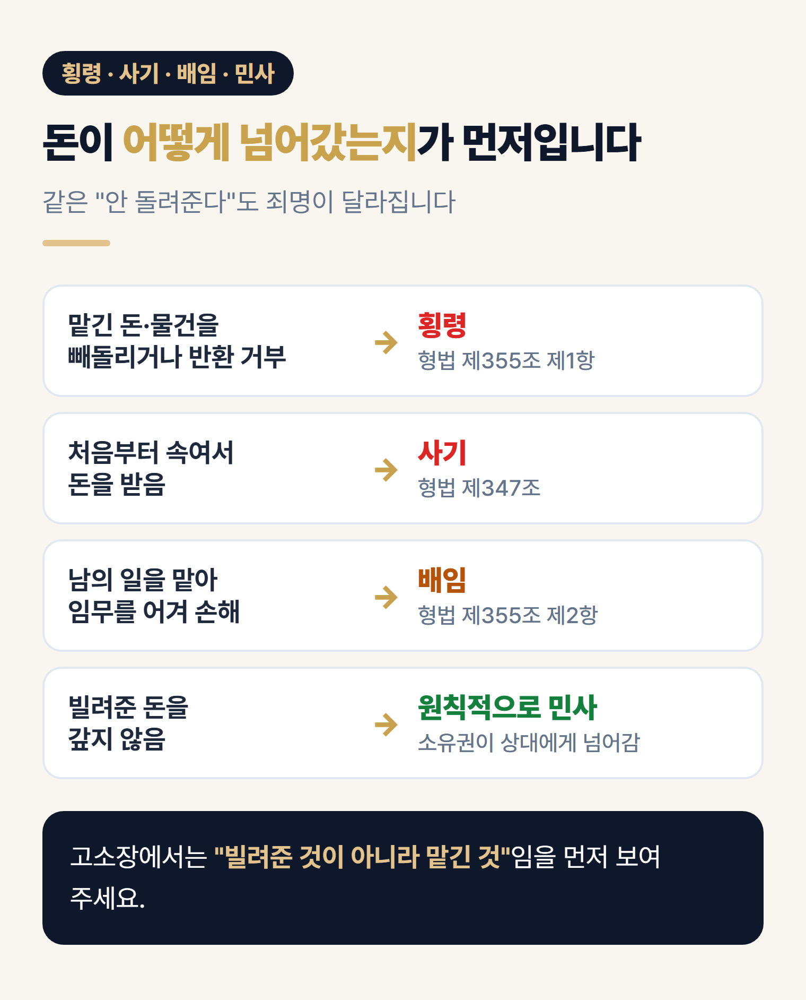
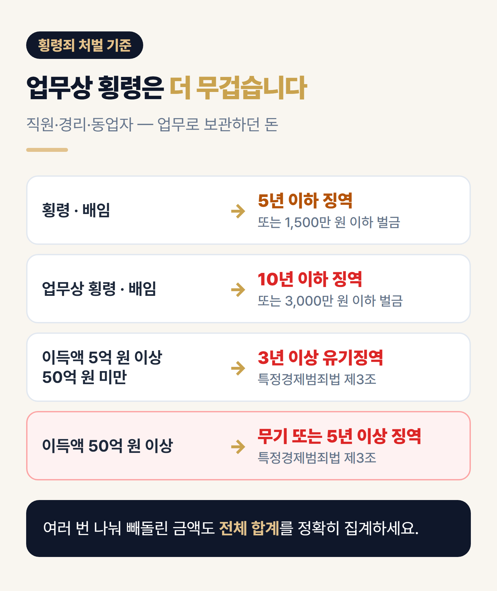
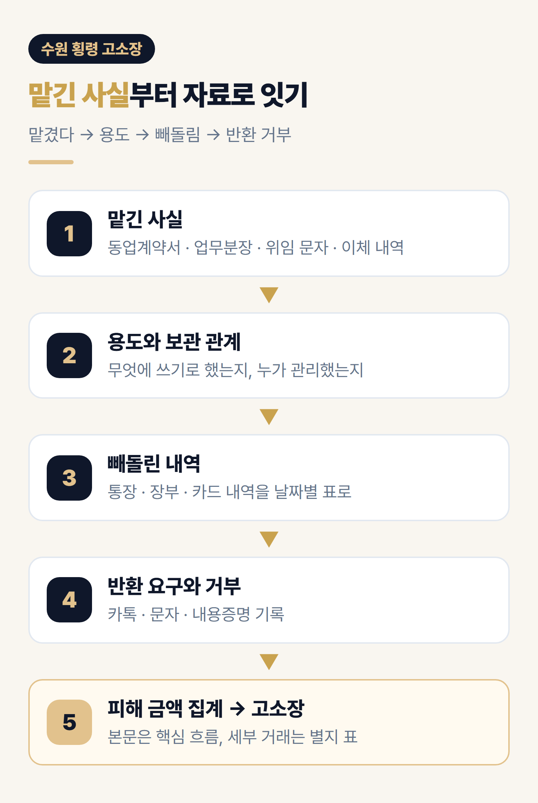

안녕하세요, 리더스 합동 법무사 사무소입니다 😊

같이 사업하던 동업자가 공동 자금을 개인 용도로 썼습니다.  
믿고 맡긴 직원이 매출금을 조금씩 빼돌린 것을 장부를 보다가 알게 됐습니다.  
대신 처리해 달라고 맡긴 돈을 돌려주지 않습니다.

이럴 때 많은 분들이 이렇게 물으십니다.

> "이거 횡령으로 고소할 수 있나요, 아니면 민사로 해야 하나요?"

결론부터 말씀드리면, **돈이 어떤 관계로 상대에게 넘어갔는지**에 따라 달라집니다.  
같은 "돈을 안 돌려준다"는 상황이라도  
**맡긴 돈**이면 횡령, **처음부터 속여서 받은 돈**이면 사기,  
**빌려준 돈**이면 원칙적으로 민사 문제가 됩니다.

오늘은 수원에서 횡령 고소장을 준비하실 때  
**무엇부터 구분하고, 어떤 자료를 어떻게 정리해야 하는지** 말씀드리겠습니다.

> ⚖️ **핵심 정리**  
> ✔ 횡령죄는 **남의 재물을 보관하는 사람**이 그것을 빼돌리거나 **반환을 거부**할 때 성립합니다  
> ✔ **빌려준 돈**은 소유권이 넘어간 것이라 원칙적으로 횡령이 아니라 민사 문제입니다  
> ✔ 직원·동업자처럼 **업무로 보관**하던 경우 **업무상 횡령**으로 더 무겁게 처벌됩니다  
> ✔ 고소장의 핵심은 **맡긴 사실 → 용도 → 빼돌린 내역 → 반환 요구**를 자료로 잇는 것입니다  
> ✔ 돈을 돌려받는 것이 목적이라면 **가압류 등 민사 절차**도 함께 검토해야 합니다

---

## 📌 횡령일까, 사기일까, 민사일까

| 상황 | 검토할 죄명·절차 | 핵심 |
|---|---|---|
| 맡긴 돈·물건을 마음대로 쓰거나 돌려주지 않음 | **횡령** (형법 제355조 제1항) | 상대가 **보관하는 사람**이었는지 |
| 처음부터 갚을 생각 없이 속여서 돈을 받음 | **사기** (형법 제347조) | **돈을 받을 때** 이미 속였는지 |
| 남의 일을 맡아 처리하면서 임무를 어겨 손해를 끼침 | **배임** (형법 제355조 제2항) | **임무 위배**와 손해 |
| 빌려준 돈을 갚지 않음 | 원칙적으로 **민사** | 빌려준 돈은 상대의 돈이 됨 |

### 빌려준 돈은 왜 횡령이 아닌가요?

돈을 **빌려주면** 그 돈의 소유권은 빌린 사람에게 넘어갑니다.  
그래서 빌린 사람이 그 돈을 어디에 쓰든 "남의 재물"을 빼돌린 것이 아니므로  
**횡령이 되기 어렵고**, 갚지 않는 문제는 원칙적으로 민사로 해결합니다.  
(처음부터 속여서 빌렸다면 사기를 검토할 수 있습니다 — 「[빌려준 돈 안 갚을 때, 사기죄 고소 vs 민사](/board/unpaid-loan-fraud-vs-civil/)」)

반면 **"이 돈으로 거래처 대금을 내 달라"처럼 용도를 정해 맡긴 돈**은  
그 용도로만 써야 하는 돈이므로,  
다른 곳에 쓰면 횡령이 문제 될 수 있습니다.

> ✔ 그래서 고소장에서는 **"빌려준 것이 아니라 맡긴 것"** 임을 보여 주는 것이 가장 먼저입니다.

---

## 📌 이런 경우에 많이 문제 됩니다

- **동업자** — 동업 자금·공동 매출을 개인 계좌로 옮기거나 개인 용도로 사용
- **직원·경리** — 매출금 입금 누락, 회사 카드 사적 사용, 거래처 대금 빼돌리기
- **대리인·심부름** — 부동산 계약금·잔금 등 전달을 부탁한 돈을 전달하지 않음
- **보관 물건** — 맡겨 둔 물건·장비를 팔아 버리거나 돌려주지 않음
- **관리인** — 모임·단체 회비, 공동 관리 자금을 임의로 사용

> ❗ 가족·친족 사이에서 생긴 횡령 사건은 처벌 특례 규정이 문제 될 수 있어  
> 고소 전에 **관계와 적용 규정을 따로 확인**하셔야 합니다.

---

## 📌 업무상 횡령은 처벌이 더 무겁습니다

| 구분 | 법정형 |
|---|---|
| **횡령·배임** (형법 제355조) | 5년 이하 징역 또는 1,500만 원 이하 벌금 |
| **업무상 횡령·배임** (형법 제356조) | 10년 이하 징역 또는 3,000만 원 이하 벌금 |
| **이득액 5억 원 이상 50억 원 미만** (특정경제범죄법 제3조) | 3년 이상 유기징역 |
| **이득액 50억 원 이상** (특정경제범죄법 제3조) | 무기 또는 5년 이상 징역 |

직원·경리·동업자처럼 **업무상 지위에서 돈을 보관**하다 빼돌린 경우  
**업무상 횡령**이 되어 더 무겁게 처벌됩니다.  
여러 번에 걸쳐 빼돌린 금액이 합쳐져 큰 금액이 되는 경우도 많으니  
**전체 피해 금액을 정확히 집계**하는 것이 중요합니다.

> ✔ 오래된 사건이라면 **공소시효**도 확인하세요.  
> 단순 횡령은 7년, 업무상 횡령은 10년이 원칙이며, 금액에 따라 달라질 수 있습니다.

---

## 📌 수원 횡령 고소장 — 무엇을 담고 어떻게 정리할까

횡령 고소장은 **"맡겼다 → 이 용도로만 써야 했다 → 다르게 썼다 → 돌려 달라고 했는데 거부했다"** 의 흐름을 자료로 잇는 문서입니다.

1. **맡긴 사실** — 동업계약서, 근로계약서·업무분장, 위임 문자, 이체 내역
2. **용도와 보관 관계** — 그 돈을 무엇에 쓰기로 했는지, 누가 관리했는지
3. **빼돌린 내역** — 통장 거래내역, 장부·매출 자료, 카드 사용 내역을 **날짜별 표**로 정리
4. **반환 요구와 거부** — 카톡·문자, **내용증명**으로 돌려 달라고 한 기록과 상대의 답
5. **피해 금액 집계** — 건별 금액과 합계, 일부 돌려받은 금액이 있다면 따로 표시

> ✔ 수십 건의 거래를 고소장 본문에 그대로 늘어놓으면 오히려 읽기 어렵습니다.  
> **본문에는 핵심 흐름을, 세부 거래는 별지 표로** 정리하는 것이 수사기관이 보기 좋습니다.

반환 요구 기록이 아직 없다면  
「[내용증명, 직접 보내도 될까](/board/content-certification-diy/)」를 참고해 먼저 기록을 남겨 두세요.  
고소장 작성의 기본 요령은 「[고소장 작성 실무 — 범죄사실 구성요건과 고소이유](/board/complaint-drafting-elements/)」에 정리해 두었습니다.

---

## 📌 돈을 돌려받는 것이 목적이라면 — 민사도 함께

형사 고소는 **상대방의 처벌**을 구하는 절차입니다.  
고소를 했다고 해서 빼돌린 돈이 자동으로 돌아오는 것은 아닙니다.

- 상대가 재산을 처분하거나 숨길 우려가 있다면 **가압류**를 먼저 검토하세요 → 「[가압류, 재산 빼돌리기 전에](/board/provisional-seizure/)」
- 수사 과정에서 합의가 이루어지기도 하지만, 합의 여부와 내용은 사안마다 다릅니다
- 민사 판결을 받은 뒤에도 갚지 않으면 **강제집행** 절차로 이어집니다

---

## 🧱 혼자 하다 막히는 지점

- **죄명 판단** — 우리 사건이 횡령인지, 사기·배임인지, 민사인지 헷갈립니다
- **"맡긴 것" 입증** — 계약서 없이 말로 맡긴 돈을 어떻게 보여 줄지 막막합니다
- **거래 정리** — 수십·수백 건의 거래내역에서 빼돌린 부분만 골라 표로 만들기 어렵습니다
- **금액 집계** — 일부 돌려받거나 섞여 쓴 돈이 있어 피해 금액이 정리되지 않습니다
- **형사·민사 순서** — 고소와 가압류 중 무엇부터 해야 할지 판단이 서지 않습니다

> 👉 횡령 사건은 **자료의 양**보다 **정리된 흐름**이 중요합니다.  
> 맡긴 사실과 빼돌린 내역이 한눈에 이어져야 수사기관이 사건을 빠르게 파악합니다.

---

## 🙋 자주 묻는 질문

**Q. 동업자가 동업 자금을 개인적으로 썼는데 횡령이 되나요?**  
A. 동업 자금은 동업자 모두의 재산이므로, 한 동업자가 다른 동업자의 동의 없이 개인 용도로 쓰면 횡령이 문제 될 수 있습니다. 다만 동업계약의 내용, 정산 관계, 사용 경위에 따라 판단이 달라지므로 계약서와 자금 흐름을 함께 정리해야 합니다.

**Q. 계약서 없이 말로만 맡긴 돈도 횡령으로 고소할 수 있나요?**  
A. 계약서가 없어도 이체 내역, 문자·카톡 대화, 녹음, 주변 사람의 진술 등으로 맡긴 사실과 용도를 보여 줄 수 있습니다. 다만 상대가 "빌린 돈"이라고 주장할 가능성이 높으므로, 용도를 정해 맡겼다는 정황을 최대한 모아 두셔야 합니다.

**Q. 고소하면 빼돌린 돈을 돌려받을 수 있나요?**  
A. 형사 고소는 처벌을 구하는 절차라 돈이 자동으로 돌아오지는 않습니다. 돌려받는 것이 목적이라면 가압류·민사소송 등 민사 절차를 함께 검토하셔야 합니다. 고소 후 불송치 결정이 나왔다면 「[불송치 이의신청, 기한과 방법 총정리](/board/non-referral-objection/)」를 참고하세요.

---

## ✅ 마무리 정리

- 횡령은 **남의 재물을 보관하는 사람**이 빼돌리거나 반환을 거부할 때 성립합니다
- **빌려준 돈**은 원칙적으로 민사, **처음부터 속였다면** 사기, **맡긴 돈**이면 횡령을 검토합니다
- 직원·동업자의 경우 **업무상 횡령**으로 더 무겁게 처벌되며, 5억 원 이상은 특정경제범죄법이 적용됩니다
- 고소장은 **맡긴 사실 → 용도 → 빼돌린 내역 → 반환 요구**를 자료로 이어야 합니다
- 세부 거래는 **날짜별 표(별지)** 로 정리하세요
- 돈을 돌려받으려면 **가압류 등 민사 절차**도 함께 준비해야 합니다

저희 리더스 합동 법무사 사무소는  
**거래내역 정리와 피해 금액 집계부터 횡령 고소장, 내용증명, 가압류 신청서까지**  
형사·민사 제출 서류를 함께 준비해 드립니다.

수원에서 고소장을 준비하신다면  
「[수원 고소장 작성 안내](/complaint/suwon)」도 함께 참고하실 수 있습니다.

> ⚠️ 리더스 합동 법무사 사무소는 고소장, 내용증명, 가압류 신청서 등 수사기관·법원 제출 서류의 작성을 대리합니다. 형사 변론과 소송대리는 변호사의 업무범위입니다. 수사·기소 여부와 처벌 결과는 수사기관과 법원의 판단에 따르며 결과를 보장하지 않습니다.

---

믿고 맡긴 돈이 사라져 막막하시다면  
언제든지 연락 주세요 😊  
맡긴 경위와 자료부터 함께 차근차근 정리해 드리겠습니다.

**법무사 직통 [031-225-6885](tel:0312256885) · [상담 게시판](/inquiry/)**

긴 글 읽어주셔서 감사합니다 🙏

리더스 합동 법무사 사무소 드림.
