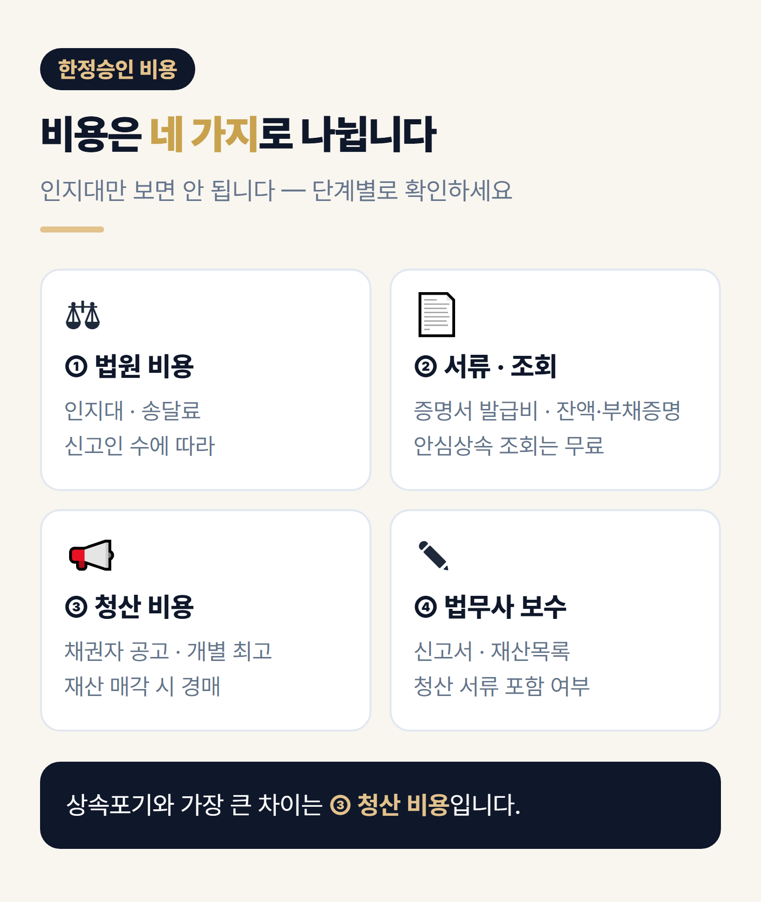
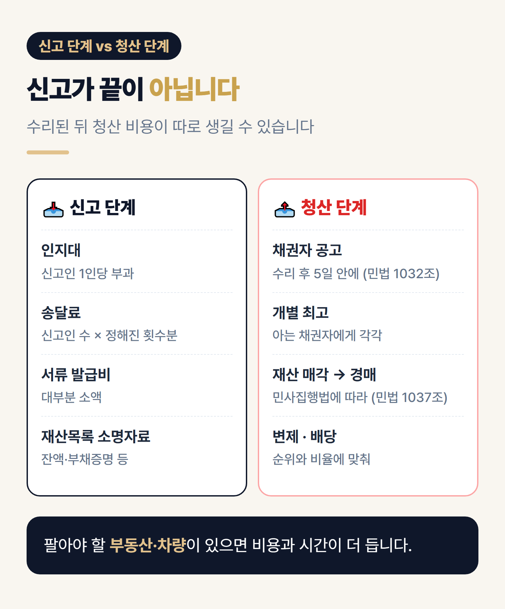
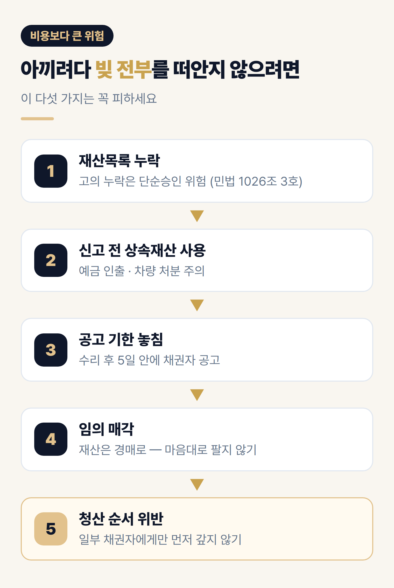

안녕하세요, 리더스 합동 법무사 사무소입니다 😊

돌아가신 부모님께 빚이 있는 것 같아  
한정승인을 알아보고 계신 분들이 가장 먼저 물으시는 것이 있습니다.

> "한정승인 하려면 비용이 얼마나 드나요?"

인터넷에서 찾아보면 "인지대 몇천 원"이라는 이야기가 많습니다.  
틀린 말은 아니지만, **그것은 신고서를 낼 때의 비용일 뿐**입니다.

한정승인은 상속포기와 달리  
**신고가 수리된 뒤에 청산 절차**가 이어지고,  
여기에서 생각하지 못한 비용이 생기는 경우가 많습니다.

오늘은 한정승인 비용을 **단계별로** 나눠서 정리해 드리겠습니다.

> ⚖️ **핵심 정리**  
> ✔ 한정승인 비용은 크게 **① 법원 비용 ② 서류·조회 비용 ③ 청산 비용 ④ 법무사 보수**로 나뉩니다  
> ✔ 법원에 내는 **인지대·송달료**는 신고인 수에 따라 달라지는 소액입니다  
> ✔ 신고 후 **채권자 공고**, 재산이 있으면 **경매** 등 청산 비용이 따로 생길 수 있습니다  
> ✔ 상속인 수, 재산·채무의 종류와 개수, 청산까지 맡기는지에 따라 전체 비용이 달라집니다  
> ✔ 비용을 아끼려다 **재산목록을 빠뜨리면** 더 큰 손해가 생길 수 있습니다

---

## 📌 한정승인 비용, 네 가지로 나뉩니다

| 구분 | 내용 | 언제 드나요 |
|---|---|---|
| **① 법원 비용** | 인지대, 송달료 | 신고서 접수할 때 |
| **② 서류·조회 비용** | 가족관계증명서·인감증명서 등 발급비, 재산 소명자료 발급비 | 신고 준비할 때 |
| **③ 청산 비용** | 채권자 공고, 재산 매각(경매) 관련 비용 등 | 신고가 수리된 뒤 |
| **④ 법무사 보수** | 신고서·재산목록 작성, 청산 절차 서류 | 맡기는 범위에 따라 |

상속포기는 대체로 ①②④에서 끝나지만,  
**한정승인은 ③ 청산 비용이 더해진다**는 점이 가장 큰 차이입니다.

---

## 📌 ① 법원 비용 — 인지대·송달료

신고서를 가정법원에 낼 때 **인지대**와 **송달료**를 납부합니다.

- **인지대** — 신고인 1인당 부과되는 소액입니다
- **송달료** — 법원이 서류를 보내는 데 드는 비용으로, 신고인 수에 따라 정해진 횟수분을 미리 냅니다

두 가지 모두 **수만 원 안쪽의 비교적 적은 금액**이지만,  
송달료 단가가 바뀌기도 하고 법원·접수 방식(방문·전자소송)에 따라 차이가 있을 수 있어  
**정확한 금액은 접수 시점에 관할 가정법원에서 확인**하시는 것이 안전합니다.

> ✔ 상속인 여러 명이 함께 한정승인을 하면 서류는 함께 준비하더라도  
> **인지대·송달료는 신고인 수만큼** 늘어납니다.

---

## 📌 ② 서류·조회 비용 — 대부분 소액, 재산 조회는 무료

신고에는 아래 서류가 필요합니다.

- 돌아가신 분의 기본증명서(또는 폐쇄등록부), 가족관계증명서, 말소자 주민등록초본
- 신고인의 가족관계증명서, 주민등록등본, 인감증명서(또는 본인서명사실확인서)
- **상속재산목록**과 이를 뒷받침하는 소명자료 (잔액증명서, 부동산 등기부, 부채증명서 등)

증명서 발급비는 통당 소액이고, 온라인 발급은 무료인 경우도 많습니다.  
재산·빚을 파악하는 **안심상속 원스톱서비스(사망자 등 재산조회 통합처리)** 는 **무료**입니다.  
조회 방법은 「[부모님 빚이 얼마인지 모를 때, 안심상속 조회부터 하세요](/board/deceased-debt-check/)」를 참고하세요.

> ❗ 다만 은행·카드사에서 **잔액증명서·부채증명서**를 받을 때  
> 기관에 따라 발급 수수료가 붙을 수 있습니다. 재산·채무가 많을수록 이 비용도 늘어납니다.

---

## 📌 ③ 청산 비용 — 한정승인에서 놓치기 쉬운 부분

한정승인은 **신고가 수리되면 끝나는 절차가 아닙니다.**  
민법은 한정승인한 사람에게 아래 의무를 지웁니다.

| 단계 | 내용 | 관련 비용 |
|---|---|---|
| **채권자 공고** | 한정승인한 날부터 **5일 안에**, 2개월 이상의 기간을 정해 채권 신고를 하라고 공고 (민법 제1032조) | 공고 게재 비용 |
| **개별 최고** | 알고 있는 채권자에게는 각각 따로 알림 | 우편 발송 비용 |
| **재산 매각** | 빚을 갚기 위해 재산을 팔아야 하면 **민사집행법에 따른 경매**로 (민법 제1037조) | 경매 신청 비용(예납금 등) |
| **변제·배당** | 순위와 비율에 맞춰 채권자에게 변제 | 서류 작성 비용 |

특히 **부동산·차량처럼 팔아야 하는 재산**이 있으면  
경매 절차에 드는 비용과 시간이 더해집니다.  
반대로 예금 몇십만 원 정도만 있고 팔 재산이 없다면 청산 비용은 상대적으로 적습니다.

> ✔ 상속에 관한 비용은 상속재산 중에서 지급한다는 규정(민법 제998조의2)이 있지만,  
> 신고 전에 돌아가신 분의 돈을 마음대로 쓰면 **단순승인**으로 볼 위험이 있습니다.  
> 어떤 비용을 어디서 낼지는 **먼저 확인한 뒤** 움직이시고, 영수증은 모두 보관하세요.  
> 「[상속포기 전에 이것만은 하지 마세요](/board/before-renunciation-dont/)」도 함께 보세요.

청산 절차 전체 흐름은 「[한정승인 신고가 끝이 아닙니다](/board/limited-acceptance-after/)」에 정리해 두었습니다.

---

## 📌 ④ 법무사 보수 — 무엇에 따라 달라지나요?

법무사 보수는 **어디까지 맡기느냐**와 **사안이 얼마나 복잡하냐**에 따라 달라집니다.

| 비용이 달라지는 요인 | 내용 |
|---|---|
| **상속인 수** | 함께 신고하는 사람이 많을수록 서류가 늘어납니다 |
| **재산·채무의 개수와 종류** | 금융기관·부동산·차량·보증채무 등이 많을수록 목록과 소명이 복잡합니다 |
| **기한 상황** | 3개월이 임박했거나, 이미 지나 **특별한정승인**을 해야 하는 경우 |
| **맡기는 범위** | 신고서·재산목록 작성까지인지, **공고·최고·변제 등 청산 서류**까지인지 |

그래서 정확한 비용은 **상속인 관계와 재산·채무 현황을 확인한 뒤** 안내드릴 수 있습니다.  
견적을 받으실 때는 **청산 단계가 포함되는지**를 꼭 확인하세요.

---

## 📌 비용을 아끼려다 더 큰 손해가 나는 경우

한정승인은 비용보다 **실수의 대가**가 더 큽니다.

1. **재산목록 누락** — 고의로 재산을 목록에 적지 않으면 단순승인으로 볼 수 있습니다 (민법 제1026조 제3호)
2. **신고 전 상속재산 사용** — 예금 인출·차량 처분 등은 단순승인 위험이 있습니다
3. **공고 기한 놓침** — 수리 후 5일 안에 해야 할 공고를 놓치면 책임 문제가 생길 수 있습니다
4. **임의 매각** — 재산을 경매가 아닌 방법으로 마음대로 팔면 문제가 될 수 있습니다
5. **청산 순서 위반** — 일부 채권자에게만 먼저 갚으면 다른 채권자에게 책임질 수 있습니다

> 👉 몇만 원을 아끼려다 **돌아가신 분의 빚 전부를 떠안게 되는 것**이 가장 큰 비용입니다.

재산과 빚이 확실하고 받을 재산이 전혀 없다면  
절차가 간단한 **상속포기**가 비용 면에서 나을 수도 있습니다.  
다만 상속포기를 하면 다음 순위 상속인에게 빚이 넘어가므로,  
「[상속포기 vs 한정승인](/board/inheritance-renounce-vs-limited/)」과  
「[상속포기하면 빚은 누구에게 넘어갈까](/board/renunciation-next-heir/)」를 함께 보고 결정하세요.

---

## 🧱 혼자 하다 막히는 지점

- **재산목록 작성** — 어떤 재산·채무를 어떤 자료로 소명해야 할지 막막합니다
- **비용 예측** — 우리 사안에서 청산 비용이 얼마나 생길지 가늠이 안 됩니다
- **공고·최고** — 수리 후 5일이라는 짧은 기한 안에 무엇을 해야 할지 모릅니다
- **재산 매각** — 부동산이나 차량을 어떻게 처리해야 하는지 어렵습니다
- **포기와 비교** — 우리 가족에게 한정승인과 상속포기 중 무엇이 나은지 판단이 서지 않습니다

---

## 🙋 자주 묻는 질문

**Q. 한정승인 비용은 상속포기보다 많이 드나요?**  
A. 신고 단계의 법원 비용은 비슷한 수준이지만, 한정승인은 신고가 수리된 뒤 채권자 공고와 재산 매각 등 청산 절차가 이어지기 때문에 전체 비용과 시간은 대체로 더 듭니다.

**Q. 상속인이 여러 명이면 비용이 사람 수만큼 늘어나나요?**  
A. 인지대·송달료는 신고인 수에 따라 늘어납니다. 서류 준비는 함께 할 수 있는 부분이 많습니다. 누가 한정승인하고 누가 포기할지에 따라서도 비용이 달라지니 「[상속인 여럿, 한정승인·상속포기 조합](/board/multiple-heirs-strategy/)」을 참고하세요.

**Q. 신문 공고 비용이나 경매 비용을 돌아가신 분 예금으로 내도 되나요?**  
A. 상속에 관한 비용은 상속재산에서 지급한다는 규정이 있지만, 신고 전에 상속재산을 쓰면 단순승인으로 볼 위험이 있습니다. 언제, 어떤 비용을 어디서 낼지는 미리 확인하고 영수증을 모두 보관하세요.

---

## ✅ 마무리 정리

- 한정승인 비용은 **법원 비용·서류 비용·청산 비용·법무사 보수**로 나뉩니다
- 인지대·송달료는 **신고인 수에 따른 소액**이며, 정확한 금액은 접수 시점에 법원에서 확인하세요
- 한정승인은 신고 후 **채권자 공고(5일 내)·경매 등 청산 비용**이 따로 생길 수 있습니다
- 전체 비용은 **상속인 수, 재산·채무 규모, 맡기는 범위**에 따라 달라집니다
- 견적을 받을 때는 **청산 단계 포함 여부**를 꼭 확인하세요
- 비용보다 큰 위험은 **재산목록 누락과 신고 전 재산 사용**입니다

저희 리더스 합동 법무사 사무소는  
**재산·채무 조회 정리부터 한정승인 신고서·상속재산목록, 채권자 공고·최고 등 청산 서류까지**  
단계별로 이어서 도와드립니다.

수원·용인·화성·오산·평택 등 경기 남부에서 진행하신다면  
「[한정승인 안내](/inheritance/limited-acceptance)」도 함께 참고하실 수 있습니다.

> ⚠️ 리더스 합동 법무사 사무소는 한정승인·상속포기 신고서, 상속재산목록, 청산 관련 서류 등 법원 제출 서류의 작성을 대리합니다. 소송대리는 변호사의 업무범위입니다. 신고 수리와 청산 결과는 법원 판단과 사안에 따라 달라지며 결과를 보장하지 않습니다.

---

우리 가족의 경우 한정승인 비용이 얼마나 들지 궁금하시다면  
언제든지 연락 주세요 😊  
상속인 관계와 재산·채무 현황부터 함께 확인해 드리겠습니다.

**법무사 직통 [031-225-6885](tel:0312256885) · [상담 게시판](/inquiry/)**

긴 글 읽어주셔서 감사합니다 🙏

리더스 합동 법무사 사무소 드림.
