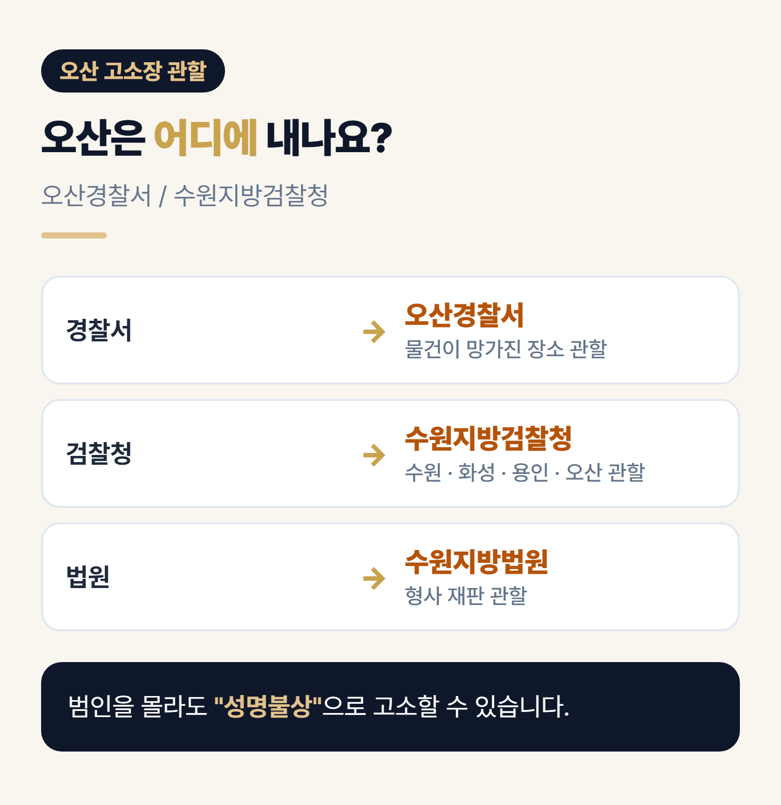
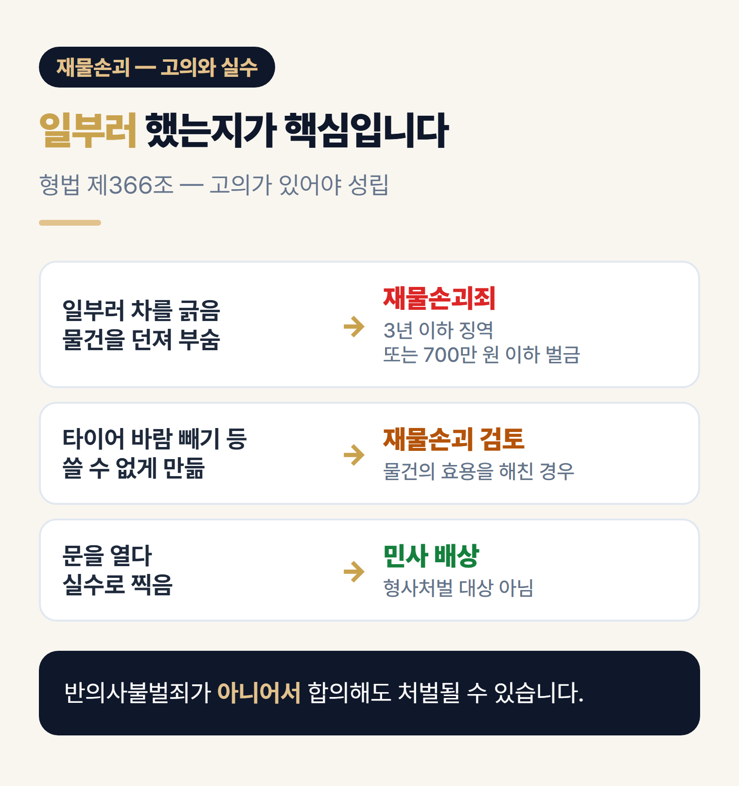
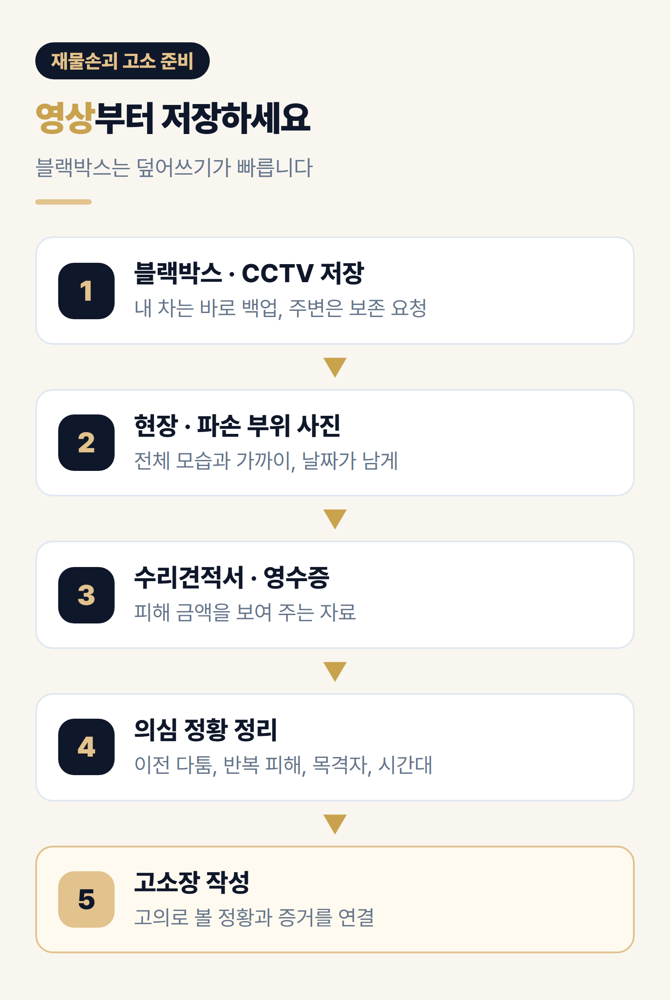

안녕하세요, 리더스 합동 법무사 사무소입니다 😊

아침에 나와 보니 주차해 둔 차 옆면이 길게 긁혀 있습니다.  
이웃과 다툰 뒤로 현관 앞 화분이 깨지고, 택배가 망가져 있습니다.  
가게 간판이나 유리문이 파손된 채 발견되기도 합니다.

이럴 때 많은 분들이 묻습니다.

> "누가 그랬는지 대충 짐작은 가는데, 고소할 수 있나요?"

오늘은 오산에서 재물손괴 고소장을 준비하실 때  
**무엇이 처벌 대상이 되고, 어떤 증거를 먼저 확보해야 하는지** 정리해 드리겠습니다.

> ⚖️ **핵심 정리**  
> ✔ 재물손괴죄는 **고의로** 남의 물건을 부수거나 쓸모없게 만들 때 성립합니다  
> ✔ **실수로** 망가뜨린 것은 형사처벌 대상이 아니고, **민사 배상** 문제입니다  
> ✔ 재물손괴는 **3년 이하 징역 또는 700만 원 이하 벌금**이며, 반의사불벌죄가 아닙니다  
> ✔ **블랙박스·CCTV**는 덮어쓰기·삭제가 빨라 가장 먼저 확보해야 합니다  
> ✔ 오산은 **오산경찰서**, 검찰은 **수원지방검찰청** 관할입니다

---

## 📌 오산 고소장, 어디에 내나요?

| 기관 | 오산 관할 |
|---|---|
| **경찰서** | 오산경찰서 |
| **검찰청** | 수원지방검찰청 |
| **법원** | 수원지방법원 |

재물손괴는 보통 **물건이 망가진 장소**를 관할하는 경찰서에서 수사합니다.  
오산에서 일어난 일이라면 오산경찰서에 신고하거나 고소장을 내면 됩니다.

> ✔ 범인을 모르는 경우에도 신고·고소할 수 있습니다.  
> 이때는 **피고소인을 "성명불상"** 으로 적고, 아는 정보(차량번호·인상착의 등)를 최대한 기재합니다.

---

## 📌 일부러 한 것일까, 실수일까

재물손괴죄(형법 제366조)는 **고의**가 있어야 성립합니다.

| 상황 | 결과 |
|---|---|
| 열쇠·날카로운 물건으로 **일부러** 차를 긁음 | **재물손괴죄** 검토 |
| 화가 나서 남의 물건을 **던지거나 부숨** | **재물손괴죄** 검토 |
| 타이어 바람을 빼거나 **쓸 수 없게** 만듦 | 효용을 해친 것으로 **재물손괴** 검토 가능 |
| 문을 열다 옆 차를 **실수로** 찍음 | 형사처벌 대상 아님 → **민사 배상** |
| 운전 중 주차된 차를 들이받음 | **교통사고**로 따로 처리될 수 있음 |

> ❗ 그래서 고소장에서는 **"일부러 했다"는 정황**이 핵심입니다.  
> 영상에 행동이 찍혔는지, 다툼 이후 반복됐는지, 긁힌 모양이 길고 일정한지 등을 정리하세요.

재물손괴는 **반의사불벌죄가 아니어서** 합의를 하더라도 처벌될 수 있습니다.  
다만 합의와 피해 회복은 처분과 형량을 정할 때 참작될 수 있습니다.

---

## 📌 지금 무엇부터 해야 하나요?

1. **블랙박스·CCTV 저장** — 내 차 블랙박스는 **덮어쓰기 전에 바로 백업**, 주변 차량·건물 관리자에게 보존 요청
2. **현장·파손 부위 사진** — 전체 모습과 가까이 찍은 사진, 날짜가 남게
3. **수리견적서·영수증** — 피해 금액을 보여 주는 자료. 정비소 견적서를 받아 두세요
4. **의심 정황 정리** — 이전 다툼, 반복된 피해, 목격자, 시간대
5. **고소장 작성** — 언제·어디서·무엇이·어떻게 망가졌는지, 고의로 볼 정황과 증거를 연결

> ✔ 아파트 주차장이라면 **관리사무소 CCTV**, 가게라면 **주변 상가 CCTV**가 있는지 먼저 확인하세요.  
> 영상은 개인이 직접 받기 어려운 경우가 많으므로, 고소장에 **영상이 있는 위치**를 적어 두는 것이 좋습니다.

---

## 📌 수리비를 받고 싶다면 — 민사도 함께

형사 고소는 처벌을 구하는 절차이고,  
**수리비는 자동으로 받아지지 않습니다.**

- 수사 과정에서 상대가 합의를 제안하며 수리비를 배상하는 경우가 있습니다
- 합의가 되지 않으면 **민사로 손해배상**을 청구해야 합니다
- 금액이 크지 않다면 **지급명령**이나 소액사건 절차를 검토할 수 있습니다 → 「[지급명령 신청](/civil/payment-order)」

---

## 🧱 혼자 하다 막히는 지점

- **고의 입증** — 일부러 한 것인지, 실수인지 어떻게 보여 줘야 할지 모르겠습니다
- **범인 특정** — 짐작만 가고 확실한 증거가 없습니다
- **영상 확보** — 블랙박스가 덮어써졌거나, 주변 CCTV를 어디에 요청해야 할지 막막합니다
- **피해 금액** — 수리비·감가 등 무엇을 피해액으로 적어야 할지 헷갈립니다
- **이웃 관계** — 반복되는 피해라 고소 이후 관계가 걱정됩니다

---

## 🙋 자주 묻는 질문

**Q. 누가 했는지 모르는데 고소할 수 있나요?**  
A. 네. 피고소인을 성명불상으로 하여 고소할 수 있습니다. 다만 수사기관이 범인을 찾을 수 있도록 블랙박스·CCTV 위치, 차량번호, 시간대 등 아는 정보를 최대한 적어 주셔야 합니다.

**Q. 문콕처럼 실수로 긁은 것도 처벌되나요?**  
A. 재물손괴죄는 고의가 있어야 성립하므로, 실수로 망가뜨린 것은 형사처벌 대상이 아닙니다. 이 경우에는 상대방이나 보험을 통해 수리비를 배상받는 민사 문제로 해결합니다.

**Q. 오산에서 생긴 일인데 어디에 고소장을 내나요?**  
A. 보통 물건이 망가진 장소를 관할하는 오산경찰서에 냅니다. 검찰은 수원지방검찰청 관할입니다. 자세한 내용은 「[오산 고소장 작성 안내](/complaint/osan/)」를 참고하세요.

---

## ✅ 마무리 정리

- 재물손괴는 **고의**가 있어야 하고, 실수는 **민사 배상** 문제입니다
- **3년 이하 징역 또는 700만 원 이하 벌금**, 반의사불벌죄가 아닙니다
- **블랙박스 백업과 CCTV 보존 요청**이 가장 먼저입니다
- **수리견적서**로 피해 금액을, **정황 정리**로 고의를 보여 주세요
- 수리비는 **합의 또는 민사 청구**로 따로 받아야 합니다
- 오산은 **오산경찰서**, 검찰은 **수원지방검찰청** 관할

저희 리더스 합동 법무사 사무소는  
**피해 경위와 증거 정리부터 재물손괴 고소장, 지급명령 신청서까지**  
형사·민사 제출 서류를 함께 준비해 드립니다.

> ⚠️ 리더스 합동 법무사 사무소는 고소장, 지급명령 신청서 등 수사기관·법원 제출 서류의 작성을 대리합니다. 형사 변론과 소송대리는 변호사의 업무범위입니다. 수사·기소 여부와 처벌 결과는 수사기관과 법원의 판단에 따르며 결과를 보장하지 않습니다.

---

반복되는 피해로 속상하시다면  
언제든지 연락 주세요 😊  
남아 있는 영상과 사진부터 함께 정리해 드리겠습니다.

**법무사 직통 [031-225-6885](tel:0312256885) · [상담 게시판](/inquiry/)**

긴 글 읽어주셔서 감사합니다 🙏

리더스 합동 법무사 사무소 드림.
