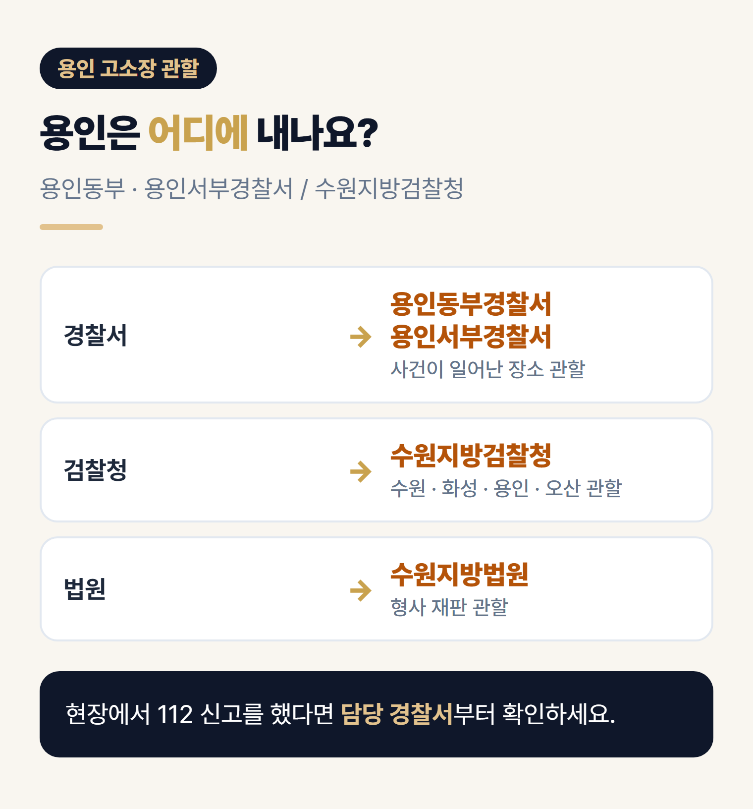
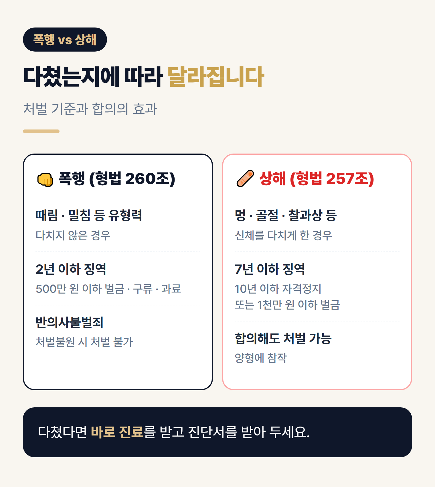
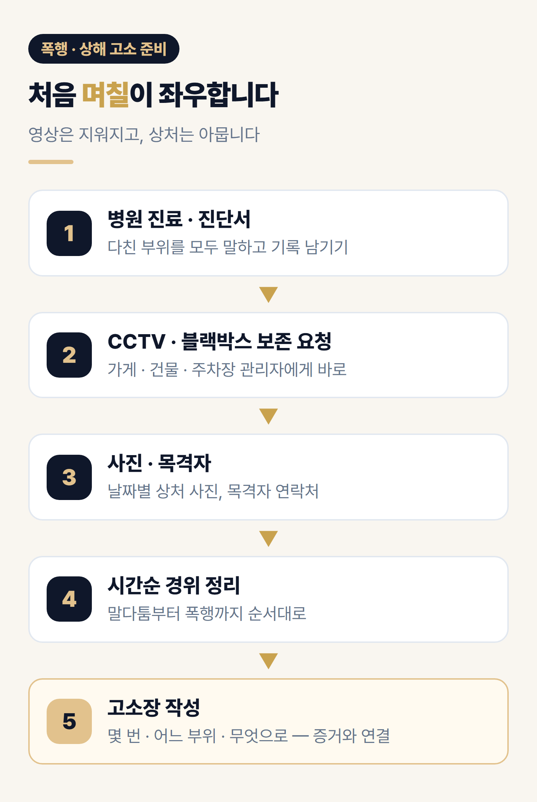

안녕하세요, 리더스 합동 법무사 사무소입니다 😊

술자리에서 시비가 붙어 맞았습니다.  
주차 문제로 다투다 상대가 밀쳐 넘어졌습니다.  
그날은 경황이 없어 그냥 집에 왔는데, 다음 날 보니 몸 여기저기가 아픕니다.

이럴 때 가장 많이 물으시는 것이 있습니다.

> "지금이라도 고소할 수 있나요? 뭘 먼저 해야 하나요?"

폭행·상해 사건은 **처음 며칠 동안 무엇을 확보했느냐**가 결과를 크게 좌우합니다.  
오늘은 용인에서 폭행·상해 고소장을 준비하실 때  
**먼저 챙길 것과 고소장에 담을 내용**을 정리해 드리겠습니다.

> ⚖️ **핵심 정리**  
> ✔ 때렸지만 다치지 않았으면 **폭행**, 다쳤으면 **상해**가 문제 됩니다  
> ✔ 폭행은 **반의사불벌죄**라 피해자가 처벌을 원하지 않으면 처벌할 수 없지만, 상해는 그렇지 않습니다  
> ✔ 다쳤다면 **바로 병원**에서 진료를 받고 **진단서**를 받아 두세요  
> ✔ **CCTV·블랙박스** 영상은 일정 기간이 지나면 지워질 수 있어 가장 먼저 확보해야 합니다  
> ✔ 용인은 **용인동부·용인서부경찰서**, 검찰은 **수원지방검찰청** 관할입니다

---

## 📌 용인 고소장, 어디에 내나요?

| 기관 | 용인 관할 |
|---|---|
| **경찰서** | 용인동부경찰서, 용인서부경찰서 |
| **검찰청** | 수원지방검찰청 |
| **법원** | 수원지방법원 |

폭행·상해 사건은 보통 **사건이 일어난 장소**를 관할하는 경찰서에서 수사합니다.  
현장에서 112 신고를 했다면 이미 사건이 접수되어 있을 수 있으니,  
**신고 여부와 담당 경찰서**를 먼저 확인하세요.  
신고하지 않았다면 고소장을 내서 수사를 시작할 수 있습니다.

---

## 📌 폭행일까, 상해일까 — 처벌과 합의가 달라집니다

| 구분 | 폭행 (형법 제260조) | 상해 (형법 제257조) |
|---|---|---|
| **의미** | 신체에 대한 유형력 행사 (때림·밀침 등) | 신체를 다치게 함 (멍·골절·찰과상 등) |
| **법정형** | 2년 이하 징역, 500만 원 이하 벌금, 구류 또는 과료 | 7년 이하 징역, 10년 이하 자격정지 또는 1천만 원 이하 벌금 |
| **합의하면** | **반의사불벌죄** — 처벌불원 의사를 밝히면 처벌 불가 | 합의해도 처벌될 수 있음 (양형에 참작) |

위험한 물건을 들거나 여러 명이 함께 폭행했다면  
**특수폭행·특수상해**로 더 무겁게 처벌될 수 있습니다.

> ✔ 같은 사건도 **진단서가 있는지**에 따라 폭행이 될지, 상해가 될지가 달라질 수 있습니다.  
> 그래서 다쳤다면 "괜찮겠지" 하지 말고 **바로 진료를 받는 것**이 중요합니다.

---

## 📌 쌍방폭행이 걱정된다면

다투는 과정에서 나도 상대를 밀거나 잡았다면  
상대가 **맞고소**를 하는 경우가 많습니다.

- 막으려고 한 행동이라도 **정당방위는 엄격하게 인정**됩니다
- 누가 먼저 시작했는지, 어떤 행동을 했는지가 **영상으로 남아 있는지**가 중요합니다
- 고소장에는 **내 행동도 사실대로** 적어야 합니다. 숨기면 진술의 신빙성이 떨어집니다

> ❗ 쌍방폭행이 문제 되는 사건이라면 처음 진술이 특히 중요합니다.  
> 「[진술서, 기억나는 대로 쓰면 왜 불리해질까](/board/statement-consistency/)」를 참고하세요.

---

## 📌 지금 무엇부터 해야 하나요?

1. **병원 진료와 진단서** — 다친 부위를 모두 말하고 진료 기록을 남기세요. 상해진단서를 받아 두세요
2. **CCTV·블랙박스 보존** — 가게·건물·주차장 관리자에게 **영상 보존을 바로 요청**하세요. 보존 기간이 짧은 곳이 많습니다
3. **사진·목격자** — 다친 부위 사진(날짜별), 찢어진 옷·깨진 안경, 목격자 연락처
4. **시간순 경위 정리** — 언제·어디서·누가·어떻게, 말다툼부터 폭행까지 순서대로
5. **고소장 작성** — 폭행 행위를 구체적으로(몇 번, 어느 부위, 무엇으로) 적고 증거를 연결

> ✔ CCTV는 개인이 직접 받기 어려운 경우가 많습니다.  
> 그럴수록 **보존 요청을 먼저** 해 두고, 고소장에 **영상이 있는 위치**를 적어 수사기관이 확보할 수 있게 하세요.

---

## 🧱 혼자 하다 막히는 지점

- **죄명 판단** — 폭행인지 상해인지, 특수폭행이 되는지 헷갈립니다
- **쌍방 문제** — 나도 상대를 밀었는데 어떻게 적어야 할지 모르겠습니다
- **영상 확보** — CCTV가 어디에 있는지, 어떻게 보존을 요청해야 할지 막막합니다
- **경위 정리** — 흥분한 상태에서 일어난 일이라 순서가 뒤엉킵니다
- **합의 여부** — 합의 제안이 왔는데 받아야 할지, 고소부터 해야 할지 고민됩니다

---

## 🙋 자주 묻는 질문

**Q. 며칠 지났는데 지금 고소해도 되나요?**  
A. 폭행·상해는 고소기간 제한이 있는 친고죄가 아니어서 지금도 고소할 수 있습니다. 다만 시간이 지날수록 CCTV가 지워지고 상처가 아물어 입증이 어려워지므로 빨리 움직이시는 것이 좋습니다.

**Q. 합의하면 사건이 끝나나요?**  
A. 단순 폭행은 반의사불벌죄라 처벌을 원하지 않는다는 의사를 밝히면 처벌할 수 없습니다. 상해는 합의해도 처벌될 수 있고, 합의는 형량을 정할 때 참작됩니다. 합의서를 쓸 때는 「[형사합의서 작성](/board/criminal-settlement-agreement/)」을 참고하세요.

**Q. 용인에서 맞았는데 어느 경찰서에 내야 하나요?**  
A. 보통 사건이 일어난 장소를 관할하는 경찰서입니다. 용인은 용인동부경찰서와 용인서부경찰서가 있습니다. 자세한 내용은 「[용인 고소장 작성 안내](/complaint/yongin/)」를 참고하세요.

---

## ✅ 마무리 정리

- 다치지 않았으면 **폭행**, 다쳤으면 **상해**
- 폭행은 **반의사불벌죄**, 상해는 합의해도 처벌될 수 있습니다
- **진단서**와 **CCTV·블랙박스 보존 요청**이 가장 먼저입니다
- 쌍방 다툼이라면 **내 행동도 사실대로**, 처음 진술을 일관되게
- 용인은 **용인동부·용인서부경찰서**, 검찰은 **수원지방검찰청** 관할

저희 리더스 합동 법무사 사무소는  
**사건 경위 정리와 증거 목록 작성부터 폭행·상해 고소장, 합의서 작성까지**  
제출 서류를 함께 준비해 드립니다.

> ⚠️ 리더스 합동 법무사 사무소는 고소장, 합의서 등 수사기관 제출 서류의 작성을 대리합니다. 형사 변론과 소송대리는 변호사의 업무범위입니다. 수사·기소 여부와 처벌 결과는 수사기관과 법원의 판단에 따르며 결과를 보장하지 않습니다.

---

폭행 사건 이후 무엇부터 해야 할지 막막하시다면  
언제든지 연락 주세요 😊  
진단서와 영상부터 함께 차근차근 정리해 드리겠습니다.

**법무사 직통 [031-225-6885](tel:0312256885) · [상담 게시판](/inquiry/)**

긴 글 읽어주셔서 감사합니다 🙏

리더스 합동 법무사 사무소 드림.
