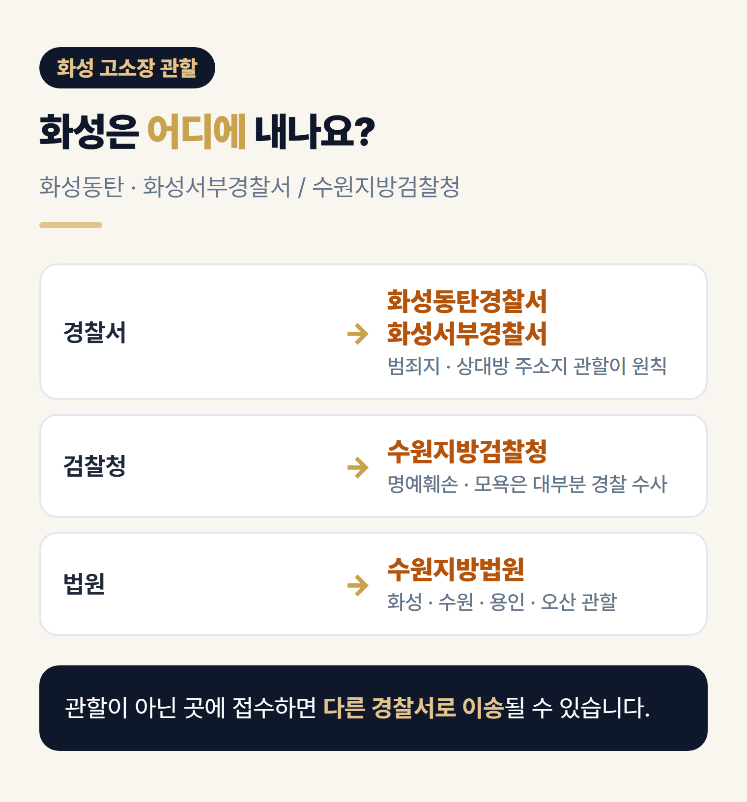
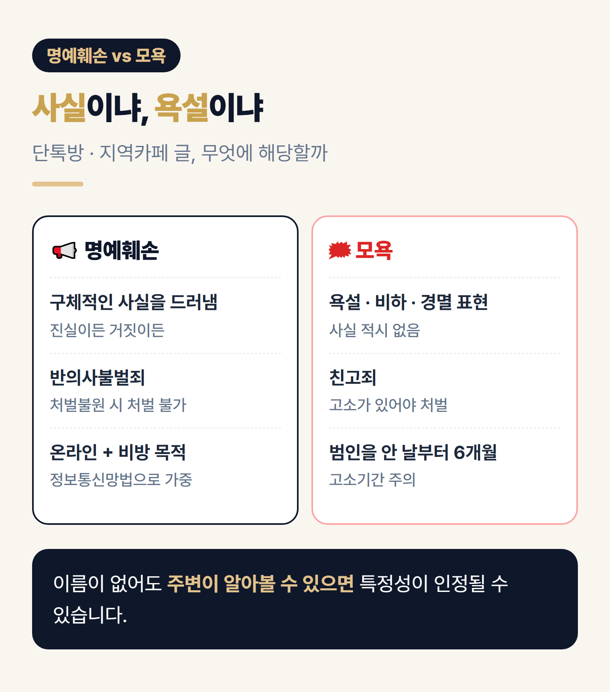
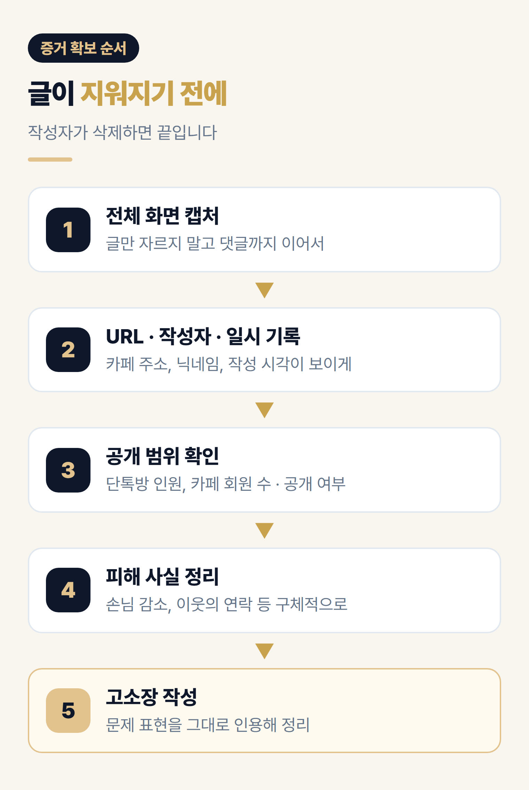

안녕하세요, 리더스 합동 법무사 사무소입니다 😊

아파트 입주민 단톡방에 내 이야기가 올라왔습니다.  
지역 카페에 우리 가게를 두고 사실과 다른 글이 퍼지고 있습니다.  
이름은 없지만, 동네 사람이라면 누구나 나라는 걸 알 수 있습니다.

화성, 특히 동탄처럼 **입주민 단톡방과 지역 커뮤니티가 활발한 곳**에서는  
이런 상담이 꾸준히 들어옵니다.

> "이름을 안 썼는데도 명예훼손이 되나요? 어디에 고소장을 내야 하나요?"

오늘은 화성에서 단톡방·지역카페 명예훼손 고소장을 준비하실 때  
**무엇부터 확인하고, 어떤 순서로 증거를 모아야 하는지** 정리해 드리겠습니다.

> ⚖️ **핵심 정리**  
> ✔ **구체적인 사실**을 들어 평가를 떨어뜨리면 명예훼손, **추상적인 욕설·비하**는 모욕입니다  
> ✔ 이름이 없어도 **주변 사람이 누구인지 알 수 있으면** 피해자가 특정된 것으로 볼 수 있습니다  
> ✔ 모욕죄는 **범인을 안 날부터 6개월** 안에 고소해야 합니다  
> ✔ 글이 지워지기 전에 **URL·작성자·일시가 보이게** 캡처하는 것이 먼저입니다  
> ✔ 화성은 **화성동탄·화성서부경찰서**, 검찰은 **수원지방검찰청** 관할입니다

---

## 📌 화성 고소장, 어디에 내나요?

| 기관 | 화성 관할 |
|---|---|
| **경찰서** | 화성동탄경찰서, 화성서부경찰서 |
| **검찰청** | 수원지방검찰청 |
| **법원** | 수원지방법원 |

고소장은 보통 **범죄가 일어난 곳**이나 **상대방 주소지**를 관할하는 경찰서에 냅니다.  
온라인 게시글은 어디서 썼는지 알기 어려운 경우가 많아,  
**내가 사는 곳 관할 경찰서**에 접수하는 경우도 많습니다.  
접수한 곳이 관할이 아니면 수사 과정에서 **다른 경찰서로 이송**될 수 있습니다.

> ✔ 검찰청에 직접 고소장을 낼 수도 있지만,  
> 명예훼손·모욕 같은 사건은 대부분 **경찰에서 수사**가 진행됩니다.

---

## 📌 명예훼손일까, 모욕일까

| 구분 | 명예훼손 | 모욕 |
|---|---|---|
| **내용** | 구체적인 **사실**을 드러냄 (진실이든 거짓이든) | 사실 없이 **욕설·비하·경멸** 표현 |
| **예시** | "○동 ○○네 가게 재료 재사용한대요" | "××같은 인간", 욕설 |
| **고소** | 반의사불벌죄 — 피해자가 처벌을 원하지 않으면 처벌 불가 | **친고죄** — 고소가 있어야 처벌 |
| **고소기간** | 별도 고소기간 제한 없음 | **범인을 안 날부터 6개월** |

온라인 게시글이라면 **비방할 목적**이 인정될 때  
정보통신망법상 명예훼손으로 더 무겁게 처벌될 수 있습니다.

| 구분 | 법정형 |
|---|---|
| **형법 명예훼손 — 사실** (제307조 제1항) | 2년 이하 징역·금고 또는 500만 원 이하 벌금 |
| **형법 명예훼손 — 허위사실** (제307조 제2항) | 5년 이하 징역, 10년 이하 자격정지 또는 1천만 원 이하 벌금 |
| **정보통신망법 — 사실** (제70조 제1항) | 3년 이하 징역 또는 3천만 원 이하 벌금 |
| **정보통신망법 — 허위사실** (제70조 제2항) | 7년 이하 징역, 10년 이하 자격정지 또는 5천만 원 이하 벌금 |
| **모욕** (형법 제311조) | 1년 이하 징역·금고 또는 200만 원 이하 벌금 |

### 단톡방·지역카페에서 특히 따지는 것

- **공연성** — 여러 사람이 볼 수 있었는지. 단톡방 인원이 적어도 **다른 사람에게 퍼질 가능성**이 있으면 인정될 수 있습니다
- **특정성** — 이름이 없어도 동·호수, 가게 이름, 별명 등으로 **주변 사람이 누구인지 알 수 있는지**
- **사실과 의견** — "~라더라"는 소문 전달도 사실을 드러낸 것이 될 수 있지만, 단순한 의견·평가는 다르게 판단될 수 있습니다

> ❗ 진실한 사실로서 **오로지 공공의 이익**을 위한 것이면 처벌되지 않을 수 있습니다(형법 제310조).  
> 예를 들어 실제 하자를 다른 입주민에게 알리는 글은 다르게 판단될 수 있으니,  
> 고소 전에 글의 내용과 맥락을 차분히 따져 보셔야 합니다.

---

## 📌 지금 무엇부터 해야 하나요? — 증거 확보 순서

게시글은 **작성자가 지우면 끝**입니다. 아래 순서로 먼저 남겨 두세요.

1. **전체 화면 캡처** — 글만 잘라 내지 말고 화면 전체를, 댓글까지 이어서
2. **URL·작성자·일시 기록** — 카페 주소, 게시글 주소, 닉네임·프로필, 작성 시각이 보이게
3. **공개 범위 확인** — 단톡방 참여 인원 수, 카페 회원 수·공개 여부
4. **피해 사실 정리** — 손님이 줄었다, 이웃이 알아보고 연락해 왔다 등 구체적인 사정
5. **고소장 작성** — 문제 표현을 **그대로 인용**하고, 어떤 부분이 사실과 다른지 정리

> ✔ 상대의 실명을 몰라도 고소할 수 있습니다.  
> 닉네임, 카페 이름, 단톡방 이름 등 **아는 정보를 최대한 적으면** 수사기관이 특정을 시도합니다.

캡처 요령은 「[카톡·댓글 사이버 명예훼손 고소, 캡처부터 고소장까지](/board/cyber-defamation-complaint/)」,  
단톡방 욕설이라면 「[단톡방에서 욕먹었는데 모욕죄 고소 될까요?](/board/groupchat-insult-complaint/)」를 함께 보세요.

---

## 🧱 혼자 하다 막히는 지점

- **죄명 판단** — 이 글이 명예훼손인지, 모욕인지, 처벌 대상이 아닌 의견인지 헷갈립니다
- **특정성** — 이름이 없는데 나라는 걸 어떻게 보여 줘야 할지 모르겠습니다
- **작성자 특정** — 닉네임만 알고 실명을 모릅니다
- **표현 정리** — 여러 글과 댓글 중 무엇을 문제 삼아야 할지 정리가 안 됩니다
- **동네 관계** — 같은 단지·동네라 고소 이후 상황이 걱정됩니다

> 👉 명예훼손 고소장은 **"어떤 표현이, 누구에게, 얼마나 퍼졌는지"** 를 정확히 보여 주는 문서입니다.

---

## 🙋 자주 묻는 질문

**Q. 단톡방 인원이 10명 정도인데도 명예훼손이 되나요?**  
A. 인원이 적어도 다른 사람에게 퍼질 가능성이 있으면 공연성이 인정될 수 있습니다. 다만 참여자 관계, 대화 내용 등 구체적인 사정에 따라 판단이 달라지므로 단톡방 인원과 성격을 함께 정리해 두세요.

**Q. 모욕 고소는 언제까지 해야 하나요?**  
A. 모욕죄는 친고죄라 범인을 안 날부터 6개월 안에 고소해야 합니다. 명예훼손은 별도의 고소기간 제한은 없지만, 증거가 사라지기 전에 빨리 움직이는 것이 좋습니다.

**Q. 화성에 사는데 어느 경찰서에 내야 하나요?**  
A. 보통 범죄지나 상대방 주소지 관할 경찰서에 내며, 온라인 사건은 피해자 주소지 관할 경찰서에 접수하는 경우도 많습니다. 화성은 화성동탄경찰서와 화성서부경찰서가 있고, 관할이 다르면 이송될 수 있습니다. 자세한 내용은 「[화성 고소장 작성 안내](/complaint/hwaseong/)」를 참고하세요.

---

## ✅ 마무리 정리

- **구체적 사실**이면 명예훼손, **욕설·비하**면 모욕
- 이름이 없어도 **주변이 알아볼 수 있으면** 특정성이 인정될 수 있습니다
- 모욕죄는 **범인을 안 날부터 6개월** 안에 고소
- 글이 지워지기 전에 **URL·작성자·일시**가 보이게 전체 캡처
- 화성은 **화성동탄·화성서부경찰서**, 검찰은 **수원지방검찰청** 관할

저희 리더스 합동 법무사 사무소는  
**게시글·대화 내용 정리부터 문제 표현 인용, 명예훼손·모욕 고소장 작성까지**  
제출 서류를 함께 준비해 드립니다.

> ⚠️ 리더스 합동 법무사 사무소는 고소장 등 수사기관 제출 서류의 작성을 대리합니다. 형사 변론과 소송대리는 변호사의 업무범위입니다. 수사·기소 여부와 처벌 결과는 수사기관과 법원의 판단에 따르며 결과를 보장하지 않습니다.

---

단톡방이나 지역카페 글 때문에 마음고생 중이시라면  
언제든지 연락 주세요 😊  
캡처해 두신 자료부터 함께 정리해 드리겠습니다.

**법무사 직통 [031-225-6885](tel:0312256885) · [상담 게시판](/inquiry/)**

긴 글 읽어주셔서 감사합니다 🙏

리더스 합동 법무사 사무소 드림.
